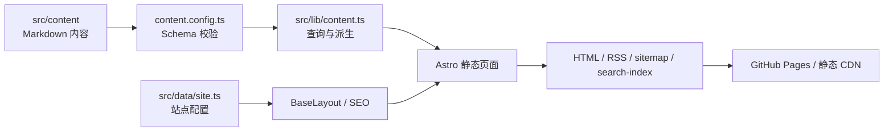

# Blog CTZ · Fourfold

一个喜欢瞎折腾的设计师 👾 不定期的分享

> 一个根据 Fourfold 模板修改的个人博客。

Fourfold 把个人博客从“文章列表”抽象成一套可长期维护的内容系统：写作是核心，专栏和标签负责发现，项目与研究提供作品档案，影像和友链扩展个人表达，搜索、收藏、RSS 和主题切换负责回访体验。

Blog CTZ 几乎完整地沿用了 Fourfold 的核心概念，但将影像修改为了更符合设计师需求的“设计”。

## 核心内容

- **专栏**：某个方向的系列文章，目前有“古建小抄”和“play with AI”两个专栏。
- **标签**：更加 P 人友好的检索方式，适合漫无目的地探索所思所想。
- **项目**：有四个状态： active、maintained、paused、archived，目前计划项目类型包括 development、research 和 design。
- **研究**：看似论文，实际上是各种不成熟的闪念想法，会用更新版本的方法不断地更新与完善。
- **设计**：以概念设计为中心的练习和设计集。
- **开始页**：为 J 人、P 人和 ? 人提供了不同的入口，分别对应不同的内容类型。
- **搜索**：页面支持标题、摘要、正文和标签匹配。

## 核心能力

- **收藏**：使用 `localStorage` 保存文章 URL；不需要账号，不上传数据。
- **主题**：CSS variables + 浏览器端明暗主题切换，并尊重系统主题。
- **发布基础设施**：RSS、sitemap、动态 robots、canonical、Open Graph、文章 `BlogPosting` JSON-LD、404。
- **内容校验**：`npm run validate:content` 检查必填字段、重复 translationKey、重复文章 URL、无效专栏和资源引用。
- **可访问性基础**：语义 HTML、Skip link、键盘焦点样式、按钮 `aria-pressed`。
- **可插拔边界**：评论、邮件订阅、云端收藏、统计和 CMS 保持为外部接入，不绑定具体供应商。

## 架构速览



完整的架构图、发布流程图、功能矩阵和运行时边界见 [`PROJECT.md`](PROJECT.md)。

## Icon Design System

所有界面图标统一由 `src/components/chrome/Icon.astro` 提供：

- `24 × 24` viewBox；
- 统一 `1.7` 线宽、圆角端点和连接；
- 通过 `currentColor` 继承主题颜色；
- 只提供 `sm / md / lg` 三种尺寸；
- 搜索、收藏、主题、复制、分页和外链都使用同一套 SVG 图标；
- 不依赖第三方图标字体或 UI 框架。

完整图标清单、按钮 hit area、focus/hover 规则和视觉 token 见 [`PROJECT.md`](PROJECT.md)。

```text
src/
├── components/       可复用 UI：壳层、文章、目录、收藏、复制链接
├── content/          Markdown 内容集合
│   ├── writing/      写作
│   ├── columns/      专栏
│   ├── projects/     项目
│   ├── research/     研究
│   ├── design/       设计
│   └── links/        友链
├── data/             站点配置、导航、UI 文案
├── layouts/          BaseLayout
├── lib/              内容查询、URL、收藏、主题工具
├── pages/            页面和 RSS endpoint
└── styles/           token、全局样式、正文样式
```
