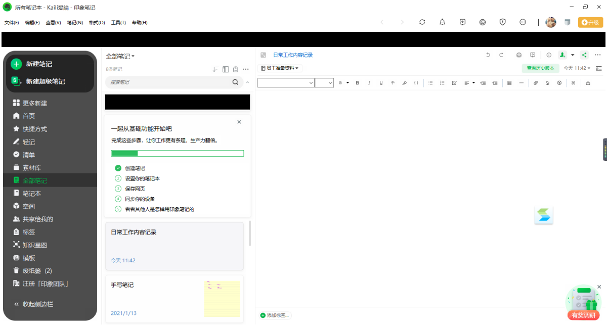
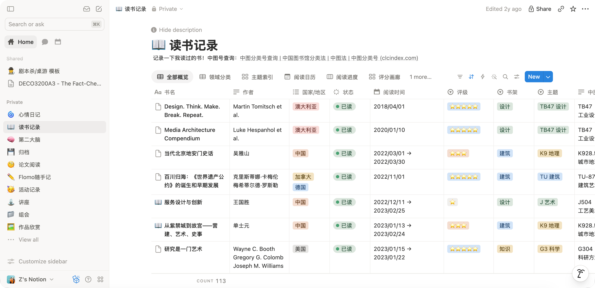
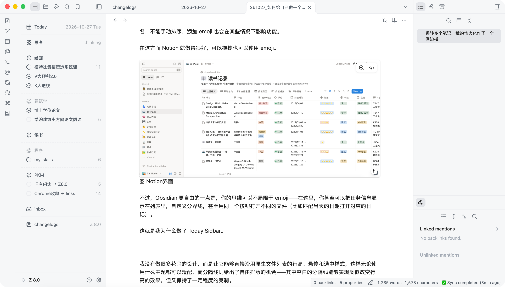
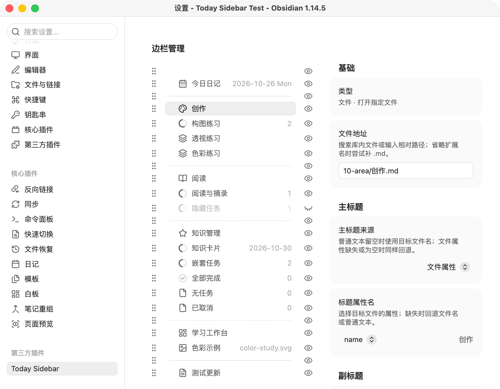
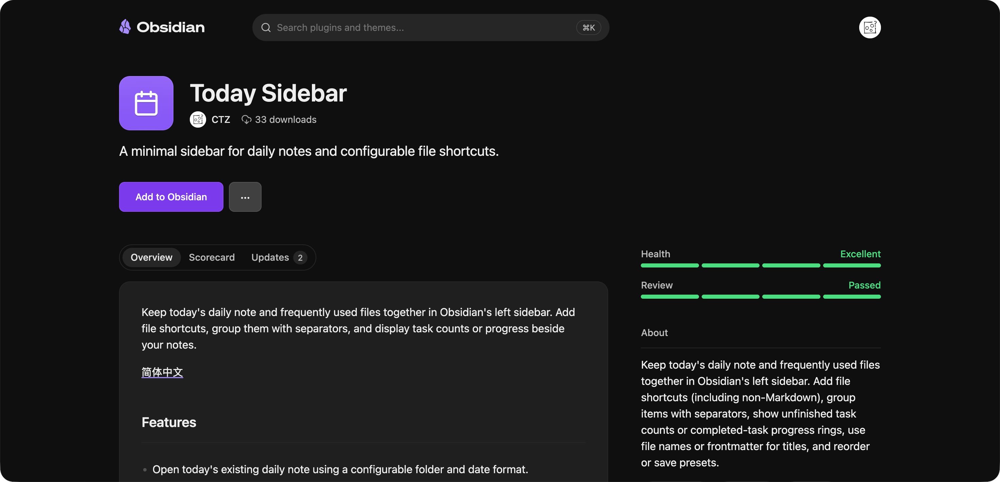

记得那是研究生的一次组会上，我看到邻座的同门在使用一款绿色主题的笔记，偷偷观察了一会儿，发现它的名字是“印象笔记”——没有想到这一眼，开启了我延续到博士生涯的笔记软件探索之路。

## 缘起

在那之前我使用的是 OneNote 和 Word，基本用法是梦到什么记什么，我根本不给笔记起名字，也很少区分文件夹。

第一次让我意识到自己必须要整理的，是在我整理本科作品集的时候。由于常年的疏于打理，我压根不知道每个文件都代表了什么。以至于我想要找到一个最终版的设计，需要一一打开软件确认才能凭着记忆回忆判断出来。

我意识到不能这样，于是开始给文件分门别类，起名也加上了日期、名称、版本等。我反复看了好几遍影视飓风数据管理的那期视频，尝试参考他们的方法给我的文件改成一个又一个长长的名字。

然而，当我使用 Word 记笔记的时候，即使我标注好每节课的名称，我很快发现按照电脑的排序方式，中文一、二、三并不能被排对。如果用创建日期排序，则对补笔记的情况很不友好。

## 道心破碎

我永远都忘不了被印象笔记自动续费一年的那一天。我找到了那年的订单，也想起了我在社交媒体上不断寻找退款方案未果的夜晚。最终我没有因此多用一年，而是火速逃离了这个软件。为了写这篇文章，我下载了印象笔记，结果发现人家压根不让我看内容。

图 印象笔记拒绝了我

当年的体验完全是在一个充满小广告的软件里记笔记，工具栏上一直飘着折扣还有几天结束，每次打开还会弹出各种提醒。最终为了去广告忍不住充了个年会员（因为月会员和季会员实在太不划算了），最后过了一年还被多扣了一年的会员费。

不过现在这个界面貌似比之前好多了，我之前印象最深的就是左侧栏有一堆我不想用的功能，像狗皮膏药一样烦人。在网上找到一个别人的截图，总之就是有大量我一次也用不上的功能一直摆在那里，非常烦人。

图 之前的印象笔记界面（来源网络）

这种对于不自由的恐惧一直延续到了现在。

## 或许……

众所周知，Obsidian 的侧栏是文件列表，因此你几乎想要显示成什么样都可以。但是这有一个前提，是你需要使其显示得符合文件列表的基本规则——这又回到了我之前用 Word 记笔记时的问题，不能重名，不能手动排序，添加 emoji 也会在某些情况下影响功能。

在这方面 Notion 就做得很好，可以拖拽也可以使用 emoji。

图 Notion界面

不过，Obsidian 更自由的一点是，你的思维可以不局限于 emoji——在这里，你甚至可以把任务信息显示在列表里，自定义分界线，甚至用同一个按钮打开不同的文件（比如匹配当天的日期打开对应的日记）。

这就是我为什么做了 Today Sidebar。

图 使用了TodaySidebar的Obsidian

我没有做花哨的设计，而是让它能够直接沿用原生文件列表的行高、悬停和选中样式，这样无论使用什么主题都可以适配，而分隔线则给出了自由排版的机会——其中空白的分隔线能够实现类似改变行高的效果，但又保持了一定程度的克制。

令人眼花缭乱的设置也是 Obsidian 众多插件劝退人的一点。我直接在设置里提供了完全一致的预览，无论是任务数还是文字内容，设置里什么样，实际显示的就是什么样。

图 TodaySidebar设置界面

## 最后

最近我的思维模式已经完全被 AI 改变了，我知道它给很多人带来了焦虑，包括我自己。但它也让我在很多时候敢于去想一些原本不敢去想做的事。

原本觉得一个 app 不好，我只能寻找替代的方案，或者去用别的 app。现在只要是开源软件，我只要觉得哪里可以改，马上就可以把它改出来。

这简直就像做梦一样。

图 TodaySidebar在ObsidianCommunity上架啦
